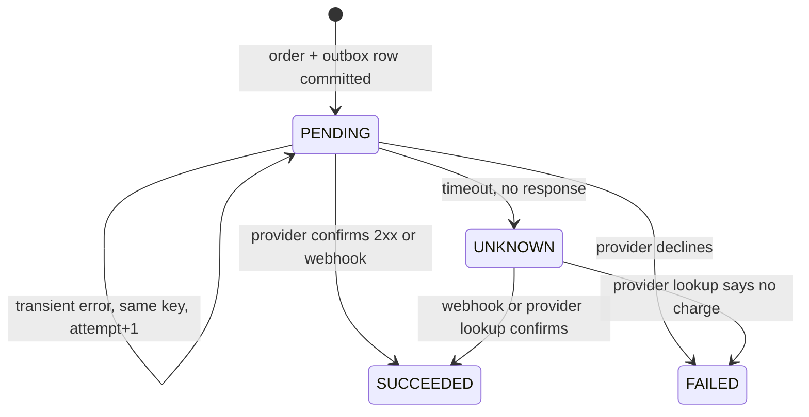
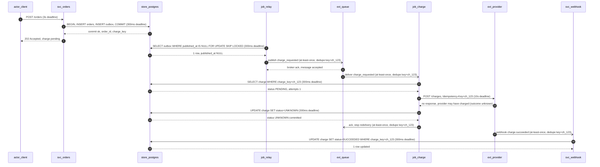

# Sample: order-to-charge flow over a redelivering queue (payment-queue scenario)

> Sample output produced with the `system-design` skill for the `payment-queue` eval case in `evals/cases.json`. Saved as an illustration of answer shape and reasoning, not as a claim of measured improvement. See `evals/README.md` for how to reproduce and score behavior cases.

**Prompt:** An order service writes an order to PostgreSQL and asks a queue worker to charge a payment provider. The queue may redeliver messages. The provider sometimes times out after accepting a charge. Product asks for exactly-once charges. Design the flow and state what guarantee you can actually make.

---

## 1. Facts, assumptions, unknowns

**Facts (from prompt):** the order row is written to PostgreSQL; a separate queue worker performs the charge; the queue is at-least-once and may redeliver; the provider sometimes times out *after* accepting a charge; the stated requirement is exactly-once charges.

**Assumptions (reversible, would confirm):** the provider honours an idempotency key, for a window at least as long as our retry-plus-reconciliation window; the provider's own record (key lookup, status query, or webhook) can settle an ambiguous attempt; one order produces at most one charge for its full amount; the queue is unordered and consumers run concurrently.

**Unknowns that would change material decisions:** the length of the provider's idempotency-key window; whether a provider status query exists at all (if not, reconciliation depends entirely on webhook delivery); whether the provider distinguishes "declined" from "not accepted"; the queue's redelivery limit, retention, and visibility timeout; whether a charge can be partially captured or later voided. I proceed without inventing a charge-error rate or a provider SLA.

---

## 2. The guarantee I can actually make

**I cannot promise exactly-once charges.** No end-to-end exactly-once is available here: the order row lives in PostgreSQL, the charge happens at a third party, and no transaction spans both. A timeout is not evidence that the charge did not happen — it is the absence of evidence. Any design that turns a timeout into "no charge" is guessing, and any design that turns it into "charged" is guessing the other way. A queue alone guarantees nothing about the provider's side effect. **What I can offer:** *effectively-once charge attempts, scoped to the charge operation only* — every attempt carries a stable business key derived from the order, the provider collapses attempts that share that key, we deduplicate redelivery locally, and we reconcile anything ambiguous. The scope is the whole point: the promise is "at most one charge per order, as confirmed by the provider's record and reconciled by us", not "exactly one charge event, always, with no human ever involved". It is conditional on the provider honouring the key, and it costs a staffed reconciliation path. **The ambiguous outcome, named:** after a timeout we do not know whether the provider charged. The order is left in state `UNKNOWN`, the client is told the charge is *pending* (HTTP 202, pollable), and the outcome is settled later from the provider's own record — never by us assuming either answer. An unresolved charge is escalated to a person; it is never auto-resolved by a timeout expiring.

---

## 3. Data, state machine, and the DB-to-queue handoff

**Owner:** the order service owns `orders`. The charge intent is one row per order (`charge_key`, `status`, `attempts`, `provider_charge_id`, `last_error`, `updated_at`) in the same PostgreSQL database, so the order and the intent to charge can commit together. **The handoff problem.** "Write the order, then publish to the queue" is two writes with no shared transaction. If the process dies between them, the order exists and the charge never happens (a lost payment, an order stuck unpaid forever). If the publish lands and the order write later fails, the worker charges for an order that does not exist (a real charge against a phantom order). No amount of retrying the publish repairs a crash in the gap. **Fix — transactional outbox.** Write the order *and* an outbox row (`order_id`, `charge_key`, `published_at NULL`) in the same transaction, so they commit or fail together. A relay polls the outbox (`SELECT ... FOR UPDATE SKIP LOCKED`), publishes, then marks `published_at`. The database is the only source of truth for "a charge is required"; the queue is just a delivery mechanism for it. **Rejected alternative:** publish-then-write, or a broker transaction, because neither spans PostgreSQL and the queue and both leave the identical dual-write gap. A change-data-capture relay over the outbox table is a variant of this design, not a different guarantee. **What the outbox does *not* remove:** (a) duplicates — the relay can publish twice if it dies after the broker ack but before the `published_at` update, so the consumer must tolerate duplicates; (b) the provider timeout ambiguity, which no local mechanism can settle; (c) latency — a charge starts one relay poll late, so the client sees "pending" for that long; (d) a stalled relay, which is invisible unless relay lag is monitored. The state machine below is the charge's lifecycle: `SUCCEEDED` and `FAILED` are terminal, `UNKNOWN` is not — it leaves only through the provider's own record, and if that never arrives it goes to a human. No transition is ever taken on our inference alone.

---

## 4. The ambiguous timeout, step by step

Scope: `actor_client` calls `svc_orders`; `job_relay` publishes committed rows from `store_postgres` to `ext_queue`; `job_charge` calls `ext_provider`; `svc_webhook` applies the provider's late answer.

The provider accepted the charge and its response never reached us (`P-->>W`, outcome unknown); a timeout ends our *wait*, not the provider's *work*. So the worker writes `UNKNOWN` — not `FAILED` — and acks the message, because a blind redelivery would re-charge. The client already holds a `202`, so money is promised but unconfirmed, and the settlement arrives later through the webhook. The webhook is at-least-once too, so its handler must be idempotent on `charge_key`: an update to a row already `SUCCEEDED` is a no-op, and it is the same code path as reconciliation. **Why the client gets 202, not 201:** the order service has committed the order and the intent to charge; it has not observed a charge. `202 Accepted` with a pollable status is the honest response — returning `201` while the charge later fails would make the API lie about a money-moving operation.

---

## 5. Idempotency and retry bounds

**Key derivation.** `charge_key = "order:" + order_id`, where `order_id` is the order's primary key generated once when the order is created. The key is *derived from the order*, never generated per attempt, so every redelivery and every retry of the same order produces an identical key. A random key per attempt is what turns "at most one charge" into "one charge per attempt" — the provider sees a new idempotency scope each time and executes each one. **What is sent:** the provider's idempotency key field or header = `charge_key`, plus amount, currency, customer reference, and `order_id` in the provider's metadata field so a human can correlate a provider charge with an order. **What is stored locally:** the `charge` row, unique on `charge_key`, holding status, attempt count, provider charge id, and last error; plus the unique outbox row. Local deduplication of redelivery is therefore a read of that row before any provider call — `SUCCEEDED` means ack with no call; `FAILED` means ack and route to review; `UNKNOWN` means route to reconciliation, not a new attempt. Local state and the provider are keyed by the same `charge_key`, so a duplicate delivery and a duplicate attempt are the same case.

**One layer owns retries:** the worker's message handler. The HTTP API and the provider client must not also retry, or the attempt budget multiplies. **Bounds:** at most 3 attempts for a *definitely-not-charged* transient failure (connection refused, provider 5xx, 429). Backoff 5s, x2, full jitter (delay uniform in [0, 5s * 2^n]) so a provider outage does not synchronise the fleet. Total elapsed budget 15 minutes, so the attempt lands inside the window the client was told "pending". **Give up when:** the provider returns a definite decline (card declined, invalid amount) -> `FAILED`, terminal, notify the client; or the attempt budget is exhausted with no definite response -> `UNKNOWN`, **not** `FAILED`, because we still do not know whether money moved. **Why a fresh key on retry of an ambiguous charge is forbidden.** After an ambiguous attempt the provider may already hold the charge. A new idempotency key opens a new idempotency scope, so the provider cannot recognise the second call as a duplicate and will execute it as a second real charge. The only safe retry of an ambiguous attempt reuses the *same* key so the provider collapses it. A different key is permissible only on positive evidence that the earlier attempt did not take effect — for example the provider's own lookup reports no record for that key — and even then the same key is preferred. Retrying an ambiguous charge with a new key is the precise failure this design exists to prevent.

---

## 6. Failure, security, operations

**Poison messages:** a message that cannot be processed (malformed payload, missing order row, a constraint violation that repeats) is retried a fixed small number of times — no exponential backoff, because a deterministic error will not heal — then moved to a dead-letter queue with the original payload, message id, and last error. It must not block the queue or the partition. DLQ depth above zero is an alert, not a silent pile-up. **Replaying the DLQ is safe:** the worker is idempotent on `charge_key`, so a replayed message either finds a terminal row and acks or finds `PENDING`/`UNKNOWN` and continues the normal path. Replay is an operator action after the cause is fixed, never automatic. **Monitoring (payment-journey signals, not infrastructure):** counts of charge attempts by outcome; **age of the oldest `UNKNOWN`** — the single most important number, because it is where money is in doubt; age of the oldest `PENDING` (relay lag); attempts per `charge_key` (a rising value means the dedup is broken); provider error classes; webhook arrival lag; DLQ depth; reconciliation backlog age. **Alerts:** oldest `UNKNOWN` older than the agreed window -> page the payments on-call; `PENDING` age beyond a few relay intervals -> ticket (the relay is stuck); DLQ depth > 0 -> ticket; attempts per key above the bound -> page (dedup regression).

**Operator reconciliation procedure** (one-page runbook):

1. List `charge` rows with status `UNKNOWN`, oldest first, with `order_id`, `charge_key`, `attempts`, `last_error`.
2. Ask the provider for the record behind `charge_key` (idempotency-key lookup or status query). The provider's record is the only authority on whether money moved.
3. If the provider shows a charge -> set `SUCCEEDED` with the provider charge id, release the order, notify the client.
4. If the provider shows no record -> the attempt did not take effect; re-queue the charge with the **same** key, or escalate for a human decision if the key has aged past the provider's idempotency window.
5. If the provider cannot answer -> escalate to provider support with the `charge_key`; keep the order unpaid and tell the client it is pending. Never guess. Write every action to an audit table (who, when, from-state, to-state, evidence) — a payment state change made by a person is the highest-risk write in this system.

**Security:** the provider credential lives in the worker's environment, never in the database or the message payload. The queue payload carries `order_id` and `charge_key` only — no card data, no customer PII. `charge_key` is guessable in principle, so provider lookups and reconciliation tooling must be access-controlled and audited. The worker needs read/write on the charge table, not on the whole database.

---

## 7. Trade-offs accepted

The outbox adds a relay and up to one poll interval of latency to every charge, plus a component to operate and to keep alive; the alternative is a lost or phantom charge, which is worse. Effectively-once depends on a third party's key semantics that we can only test, not control — so the design keeps a reconciliation path that still works if the provider's key handling is weaker than documented, at the cost of human effort on ambiguous charges. Local deduplication means the queue must be treated as at-least-once forever, not only until the first incident. We accept that some orders will visibly sit "pending" for minutes and that a few will need a person, because the alternative is double-charging patients or silently losing revenue.

*Evidence that would change this answer: the provider confirming it does not honour idempotency keys (the guarantee then degrades to at-least-once, and duplicate charges need a compensating refund — a saga, not a retry); the provider exposing neither a key lookup nor a status query (webhooks become the only reconciliation channel, so their delivery guarantees enter the design); a charge whose amount can change between attempts (the key must then carry an amount version, still derived from the order rather than random); or a charge that is one step of a multi-step business flow (a saga with compensation, not a retry loop).*
