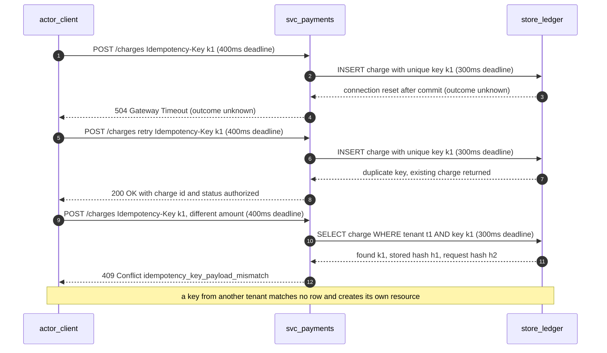

# API and contract design

Use this for: designing an interface another team or an external client consumes - resource shape, versioning, idempotency, pagination, error contracts, and rate limits.
Sources: [RFC 9110 HTTP semantics](sources.md#api-and-protocol-design), [RFC 9457 problem details](sources.md#api-and-protocol-design), [OpenAPI Specification](sources.md#api-and-protocol-design), [Microsoft API design](sources.md#api-and-protocol-design), [Pact consumer-driven contract testing](sources.md#api-and-protocol-design).

## Begin with consumers and semantics

Identify callers (browser, mobile, partner, internal service, batch, webhook), user journeys, resource/command model, authorization context, traffic, compatibility period, and transport requirements. Keep public contracts separate from internal database schemas. Define behavior, not just JSON shape.

## Interface family comparison

| Aspect | REST over HTTP | gRPC | GraphQL | Events |
|---|---|---|---|---|
| Interaction | Resource request/response, one intent per call | Strongly typed unary or streaming RPC | Client-shaped query, server-resolved field graph | Asynchronous publish, no caller present |
| Caller support | Any HTTP client, browser, partner tooling | Needs a stub or proxy; a browser needs a bridge | Browser-native, one endpoint, flexible selection | Producer and consumer decoupled, often in different languages |
| Payload | Text encoding, verbose headers, duplicated fields | Compact binary, generated stubs | Response limited to selected fields, query and resolver overhead | Batchable records, headers per message |
| Coupling | Additive fields usually safe; unknown-field tolerance varies by client | Schema is the contract; a changed field type breaks both builds | Schema is the contract; removing a field breaks any client that selected it | Producer and registry are the contract; consumers must tolerate evolution |
| Caching | Native HTTP cache semantics, validators, conditional requests | Not natively cacheable at the protocol level | Usually disabled or custom | No request cache; replay and retention substitute for it |
| Authorization | Per request and route, often at a gateway | Per method and message, in the service or interceptor | Per resolver and per field, at a cost | Per subscription and per message, at the consumer |
| Main failure mode | Over-fetching, chatty chains, payload coupling | Chatty methods, tooling friction, streaming state leaks | Query cost explosion, N+1 resolvers, resolver-level authz bugs | Duplicate, reordered, or missing delivery, poison messages, lag |
| Fit | Public and partner APIs, CRUD, low internal churn | Internal service-to-service calls with a shared language, streaming | Aggregated read APIs with many client shapes | Fan-out state propagation, decoupling, buffering |

The family is a choice about coupling, not a quality ladder. A public API that must outlive its client should not be a GraphQL schema, and an internal path that does not need streaming should not pay for a streaming RPC stack.

## Contract checklist

- Resource identity, names, methods/actions, request/response schemas, required/optional/null behavior, defaults, enums, units, and validation.
- Authentication and authorization by action, object, property, tenant, and workflow state.
- HTTP status semantics, headers, conditional requests/caching, stable machine-readable errors, and safe messages.
- Filtering, ordering, deterministic pagination, page size limits, and token expiry/opacity.
- Payload limits, rate limits, quotas, deadlines, `Retry-After`, concurrency, and abuse controls.
- Partial update semantics, field masks, optimistic concurrency/ETags, and conflict responses.
- Async operation acceptance, status resource, progress, cancellation, deduplication, and expiry.
- Webhook signing, replay window, retries, delivery IDs, ordering, and consumer idempotency.
- Compatibility policy, deprecation/support window, migration examples, and generated contract validation.

Use OpenAPI for HTTP contract description when it fits; use `.proto` and compatibility checks for gRPC; GraphQL SDL/schema validation for GraphQL. A schema tool does not prove authorization, semantics, performance, or end-to-end compatibility. Test negative authorization and old-client behavior.

## Idempotency mechanics

A timeout is ambiguous: the server may have committed before the response was lost. A header named `Idempotency-Key` is a request for a behaviour, not the behaviour. Define the mechanics or the guarantee does not exist.

**Scope the key to the caller.** The idempotency record is identified by the pair (authenticated principal or API client, tenant, key). A key is never global. A client in tenant A submitting tenant B's key must not receive tenant B's resource, and must not learn that the key exists: it is treated as a fresh key, and the resulting resource belongs to the submitting tenant.

**Bind the key to the tenant.** Store the tenant identifier with the record and include it in the uniqueness constraint. A uniqueness constraint on the bare key alone is a cross-tenant information leak and a cross-tenant write hazard: tenant A can collide with, or suppress, tenant B's write.

**Fingerprint the payload.** Store a canonical hash of the request body. On a repeat with the same tenant and key: same fingerprint returns the original response and status, marked as a replay; a different fingerprint returns `409 Conflict` with a stable code such as `idempotency_key_payload_mismatch`, and the second request is not processed; a different tenant is treated as a new key, and the other tenant's record is unreachable.

**Store the record atomically with the effect.** The key record and the business write commit in one transaction, or the guarantee is a race: two concurrent requests with the same key can both pass the lookup and both write. Enforce uniqueness in the storage engine and treat a uniqueness violation on insert as the signal to load and replay.

**Retain the key longer than any retry window.** Retention must exceed the client's longest retry period, the maximum request deadline, and the maximum end-to-end retry budget across all layers, plus a margin. A key that expires while a client is still retrying converts a duplicate into a second effect.

**Bound the replayed response.** Store the response status and body, or a deterministic reference to them. A repeated `POST` on an asynchronous operation returns the operation resource, not a new operation. Idempotency is scoped to an operation, not to a resource, so include the operation identity in the key's scope or require distinct key namespaces per operation.

**Rejections are not stored.** A `4xx` caused by invalid input is normally not recorded, so the client may correct the request and reuse the key. A `5xx` or an unknown outcome is recorded, or the key is released, because the effect may exist. State which statuses are stored.

**Concurrent duplicates.** A second request with the same key while the first is in flight waits and then replays, or returns `409` with a retryable marker; it does not start a second effect. A first request still running past its bound times out, and that timeout is again ambiguous rather than a failure.

### Ambiguous timeout and retry

The timeout does not cancel the server-side work, so the client cannot distinguish "the write did not happen" from "the response was lost", which is why the retry carries the same key. The 409 is the only safe answer to a reused key with a different body.

## Pagination

- **Offset pagination** (`limit`, `offset`) is simple but degrades three ways: a deep offset costs more because the skipped rows are still walked, page contents shift when rows are inserted or deleted, and the total count is computed separately and inconsistently. Use it for small, stable, admin-facing data with bounded page depth.
- **Cursor pagination** anchors on a sort key and returns an opaque token. A deep cursor costs the same as the first page, and inserts ahead of the cursor do not shift later pages. It does not support jumping to an arbitrary page number.
- **Keyset pagination** is the cursor mechanism applied as an indexed range scan on a specific store.

State the total order over the sort key and the tiebreaker that makes it total, the maximum and default page size, and whether a request above the maximum is clamped or rejected. The token is opaque: clients must not parse it, it may be signed so it cannot be forged, and it should expire when the underlying data can be purged. Say whether the traversal is a snapshot or a moving target, and for offset pagination, the maximum offset served. A cursor is only valid for the filter and sort it was issued under, so a client that changes filters restarts the traversal.

## Error contract

Use RFC 9457 problem details for the body shape and add the fields clients branch on.

    HTTP/1.1 429 Too Many Requests
    Content-Type: application/problem+json
    Retry-After: 30

    {
      "type": "https://errors.example.com/rate-limited",
      "title": "Request rate limit exceeded",
      "status": 429,
      "code": "rate_limit_exceeded",
      "detail": "Tenant t1 exceeded 600 requests in the current 60 second window.",
      "instance": "/v1/payments",
      "request_id": "req_1a77",
      "retryable": true
    }

- `type` is a stable URI for the error kind, `title` a short human summary, `status` mirrors the HTTP status, and `detail` explains this occurrence without leaking internals.
- `code` is the machine-readable discriminator. Clients branch on `code`, never on `detail` or `title`. The code set is part of the contract and is versioned with it.
- `retryable` separates "retry later" from "fix your request". A `429` with `Retry-After` is retryable; a `409 idempotency_key_payload_mismatch` is not, and retrying it forever is a client bug. A `503` from dependency overload is retryable, a `403` is not. An unexplained `5xx` is treated as retryable by convention, with bounded attempts, and the convention is stated.
- `request_id` is returned on every response, including successes, and appears in server logs.
- Status semantics follow the protocol: `400` malformed or schema-invalid, `401` missing or invalid authentication, `403` authenticated but not permitted, `404` absent or not knowable, `405` unsupported method, `409` state conflict, `412` failed precondition such as a stale `If-Match`, `422` well-formed but semantically invalid, `429` rate limit, `503` temporarily unavailable with `Retry-After` where known. Never return `200` with an error flag in the body, and never return `500` for a client mistake.
- Never return a stack trace, an internal hostname, a query plan, a secret, a personal datum, or the existence of a resource the caller may not see. Where existence is sensitive, `404` replaces `403`.
- The error catalogue lists every `code`, its status, whether it is retryable, its likely cause, and the client action. Adding a code is compatible; changing the meaning of one is not.

## Versioning

- **Additive changes are compatible** under one rule: a consumer that ignores unknown fields still behaves correctly. Adding an optional request field, adding a response field, adding an endpoint, adding an enum value the consumer does not branch on, and relaxing a validation are additive. A change that requires the consumer to do something new is not additive, however small it looks.
- **Breaking changes** include removing or renaming a field, changing its type, unit, currency, or format, changing a default, making an optional request field mandatory, narrowing an accepted range, changing a documented status code, changing the meaning of an enum value, changing pagination or ordering semantics, and changing the meaning of an existing error code.
- **Version negotiation**: a path segment is visible, routable, and easy to deprecate; a header keeps the URL stable but is invisible in logs and easy to lose in a proxy; a query parameter is the weakest. A service that never versions explicitly still versions, because the day it ships an incompatible change it has.
- **Sunset**: a deprecation is announced with a date and a mechanism. Send `Deprecation` and `Sunset` headers on the deprecated version, publish a migration note with before-and-after examples, name the replacement, measure usage of the old version, and retire only when usage is gone.
- **Compatibility window**: state the minimum support period in the contract, and for internal services in the team's working agreement, because an internal API is still consumed by an unsynchronized deploy cycle. The window must exceed the time the slowest known consumer needs to plan, implement, test, and roll out a change.
- Prefer deprecating a field over removing it, and prefer a server that tolerates old clients over a client migration deadline. A compatibility layer with no retirement criteria is a permanent second system.

## Rate limiting and quotas

- **Algorithm.** A **token bucket** refills at a steady rate with a bounded burst and is the usual default. A **leaky bucket** drains at a fixed rate and smooths downstream load but punishes bursts. A **sliding window log** counts each request's exact timestamp, is accurate, and stores per-request state. A **sliding window counter** approximates it with two fixed buckets. **GCRA** expresses the limit as one emission interval plus a tolerance, which makes it a natural fit for a distributed limiter because the state per key is a single timestamp.
- **Where enforcement lives.** The layer that owns the scarce resource. A gateway limiter protects the platform from abusive clients and is cheap, but it cannot see per-tenant fairness or internal calls. A service limiter knows the true cost of the operation, so a cheap read and an expensive report can carry different weights. The usual pattern is a coarse gateway limit plus a per-tenant limit in the owning service, with the two budgets not multiplying into a surprising effective cap.
- **The shared-state problem.** A limit enforced in each instance of a fleet is a limit per instance, so the effective global limit scales with the fleet size, and the fleet size scales with load, which is a limit that does not limit. The limit must be enforced against shared state, or the per-instance share of the global budget must be divided by the instance count, which is approximate. A shared counter adds a dependency on the hot path; a local approximation trades exactness for availability. State the choice and the behaviour when the shared store is unavailable: fail closed rejects traffic, fail open loses the limit, and the choice belongs to the endpoint's SLO, not to the implementation.
- **Response.** On limit: HTTP `429`, a stable error code, and `Retry-After` in seconds giving the earliest time the next request would be admitted. The header must be honest, because a client that trusts it paces itself. A jittered value derived from the actual token state is better than a fixed one.
- **Quotas are not rate limits.** A rate limit bounds burst rate; a quota bounds volume over a period and is a business rule as much as an infrastructure rule. Quotas are per tenant, per plan, and often hierarchical, and the most specific limit is not automatically the binding one. A quota breach can be an error, a throttle, or a scheduled deferral, and that is a product decision.
- **Fairness.** A single global limit lets one tenant consume the whole budget. Per-tenant buckets under a shared global ceiling, plus a burst allowance, is the usual shape. Define what happens when one tenant is noisy: does it degrade only itself, or can it push others over their own limits through a shared dependency?
- **Advertise the limit.** Publish the limit, window, bucket size, and `Retry-After` semantics, and return the remaining budget in response headers where it is cheap. A client that cannot see the limit cannot pace itself, and will retry in a way that sustains the overload.

## HTTP, retries, and idempotency

Follow RFC 9110 semantics for safe and idempotent methods. A timeout is ambiguous: the server may have committed before the response was lost. Never blindly retry side effects. For retryable create/payment/job operations, define an idempotency key's caller scope, tenant binding, retention, payload mismatch behavior, concurrent duplicates, response replay, and atomicity with the business effect. A header alone is not a guarantee.

Bound retries and coordinate a total deadline/retry budget across layers. Use backoff and jitter for transient failures where retry can help. Respect throttling signals. Avoid retry storms, nested retry multiplication, and retrying permanent validation/authorization errors.

## Errors and compatibility

Return correct protocol status plus stable machine-readable code/type, safe detail, and request/correlation identifier. RFC 9457 problem details can standardize HTTP error bodies; avoid leaking stack traces, internal hostnames, secrets, or personal data. Treat status, schema, enum meaning, ordering, defaults, and pagination behavior as compatibility surfaces. Additive changes can still break clients if their assumptions are undocumented.

Choose and document a versioning/deprecation model. Version only when needed; preserve old behavior for a stated support window; measure usage before retirement. Consumer-driven contract tests help independently deployed services, but complement provider tests, security testing, schema compatibility, and integration tests.

## Security/API abuse review

Check object-, property-, and function-level authorization; mass assignment; cross-tenant access; excessive data exposure; SSRF; injection; unbounded list/query cost; batch amplification; unsafe upstream data; and inventory of old endpoints. Validate authorization inside the service that owns the resource, not only at a gateway. API keys identify a client/application in some contexts but are not end-user authentication or a hard billing/security boundary by default.

## Recommended sources

Use RFC 9110 and RFC 9457 for HTTP semantics/errors; OpenAPI specification for HTTP description; RFC 9700 and current OpenID specifications for OAuth/OIDC security; OWASP API Security Top 10 as awareness input, not exhaustive assurance. Google AIPs are useful published conventions, not universal standards. Verify current versions when working on a specific contract. See [sources](sources.md).
