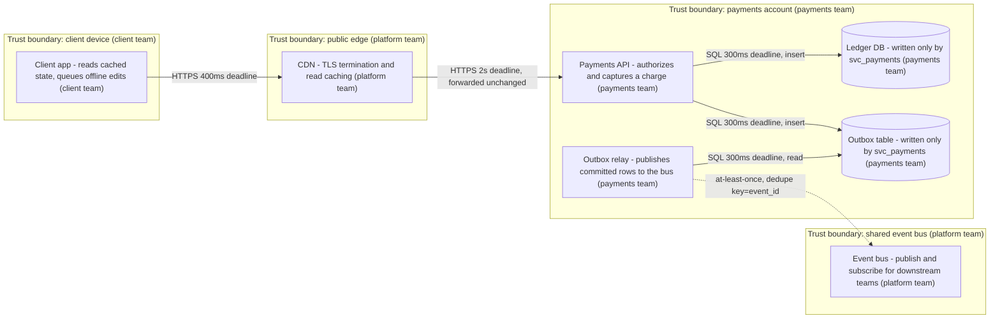
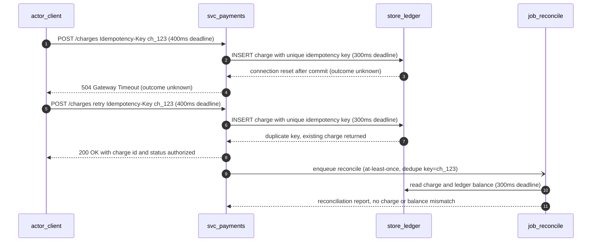

# Diagram style and conventions

Use this for: every Mermaid diagram in an architecture document, so a reader can trust what a shape and an arrow mean. Sources: [C4 model](sources.md#skills-format-and-architecture-foundations), [Google SRE books](sources.md#sre-reliability-operations), [RFC 9110](sources.md#api-and-protocol-design).

## Node naming and shapes

A node is one deployable or one logical component, never a layer of one. The id carries a kind prefix: `svc_` a service the owning team runs, `job_` a scheduled or event-triggered worker, `ext_` a dependency the design calls but does not own, `actor_` a human or external system that initiates requests, `store_` a datastore. The label form is `Responsibility - detail (owner)`. A store uses the cylinder shape `store_id[("Ledger DB - written only by svc_payments (payments team)")]`. Exactly one component is labelled as the writer of each store, and the store label names it; if two components write one store, they are one component or the store is not a boundary. Quote every label and keep it to a short phrase.

## Edge semantics

| Style | Means | Label must carry |
| --- | --- | --- |
| Flowchart `-->` | request and response | the operation and its deadline, such as `HTTPS 400ms deadline` |
| Flowchart `-.->` | asynchronous publication | the delivery guarantee and the dedupe key, such as `at-least-once, dedupe key=event_id` |
| Sequence `->>` and `-->>` | request and response | the deadline on the request, the outcome on the response, and `outcome unknown` where the outcome is ambiguous |
| Sequence `->` or `-)` | asynchronous delivery | the delivery guarantee and the dedupe key |

Never mix the two on one edge: a solid edge is not a disguised event and a dotted edge is not a disguised request. Never draw an arrow that implies a guarantee the prose does not make, and never write one on an edge that the surrounding text has not established. A deadline is a budget, not a measurement, and a diagram without deadlines hides an unknown. A queue drawn without its redelivery and dedupe behavior is incomplete: name the attempt limit, the backoff, the dead-letter destination, and the dedupe key the consumer uses.

## Trust boundaries

A boundary is a subgraph titled `Trust boundary: <scope> (<owner>)`, marking a trust and ownership line rather than a network diagram. Draw one where a different party controls the component, where data crosses a compliance or tenant line, or where credentials change. Never rely on colour alone: the boundary is named and the owner is in the title, so the diagram reads in monochrome. Nest at most two deep.

## Size, form, and pre-publication check

At most 12 nodes and 3 levels of nesting per diagram. Beyond that, split by level, context then containers then components, each with its own scope sentence. A single component with a single store needs no diagram. A diagram that does not fit on one page is a diagram nobody reads.

| Reader question | Form | Minimum content |
| --- | --- | --- |
| Which option wins and what each costs | comparison table | criteria, options, consequence |
| What happens in what order, and what fails | sequence diagram | participants, deadlines, failure point, retry, outcome |
| What are the entities and how do they relate | entity relationship diagram | keys, cardinality, ownership, constraints |
| Where does this run and who owns it | context or container flowchart | components, boundaries, owners, sync and async edges |
| More than 12 nodes | several diagrams, one per level | a scope sentence above each |

## Example 1: context and container view

The API is the only writer of both stores and the relay only reads the outbox, so the diagram states the ownership rule instead of leaving it to the prose.

## Example 2: a write whose outcome is unknown

The first response says `outcome unknown` because a timeout does not prove the write did not happen. The retry is safe because the idempotency key is unique in the store, and the reconcile step settles anything the retry path could not. The prose must state the same three things, or the diagram claims guarantees the design does not have.

Before publishing, check that every node has a kind prefix, a responsibility, and an owner; that every store names exactly one writer and every boundary names a scope and an owner; that every request edge carries a deadline and every async edge a delivery guarantee and a dedupe key; that the diagram states nothing the prose does not; and that the Mermaid renders with balanced brackets, valid shapes, and quoted labels.
