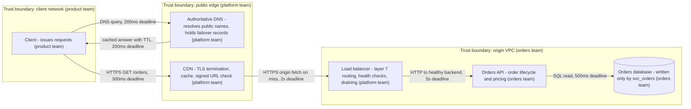

# Networking, DNS, CDN, and edge

Use this for: name resolution, load balancing, cache placement, and edge execution, and their failure behavior. Sources: [RFC 9110](sources.md#api-and-protocol-design), [Google SRE on cascading failures](sources.md#sre-reliability-operations), [AWS Builders' Library](sources.md#first-party-engineering-case-studies), [C4 model](sources.md#skills-format-and-architecture-foundations).

## DNS is a distributed system with a global cache

A resolver answers from its own cache, a recursive provider, and authoritative nameservers, and clients add caches on top: the operating system, the browser, the mobile network resolver, and the application runtime. A record change is visible only after every cache in the path expires or revalidates the old answer. A lower TTL shortens propagation and enlarges the answer surface to poison; a higher TTL makes failover slow. Set the TTL from the failure budget: a failover record written by a health check must outlive detection plus record propagation, or it does not help. Negative answers are cached too, so a bad configuration becomes a hard failure for the whole TTL; validate changes out of band.

DNS TTL also slows scaling, because a fleet that becomes visible through a name inherits the TTL as a delay, and service discovery inherits the client cache with it. Some runtimes cache a successful lookup for the life of the process, so a record change may need a restart to be observed. Use a discovery mechanism with a push or a short, explicitly bounded TTL for traffic that must move quickly, and measure end-to-end propagation instead of trusting the record. Split-horizon DNS gives an internal name a different answer from the public name, the usual way to reach private backends, pin a region, or test a candidate without a public change; record which views exist, because a name that resolves differently in two places has two failure stories. DNSSEC validation and CAA records reduce hijacking risk, but they do not protect a compromised resolver.

## Load balancing

| Layer | Operates on | Can do | Costs and limits |
| --- | --- | --- | --- |
| DNS or anycast | destination address | coarse geographic routing | no per-request decision, long client caches |
| Layer 4 | TCP and UDP connections | high throughput, protocol transparency, keeps the client address | no path, header, or auth inspection, TLS must end further along |
| Layer 7 | HTTP request and response | path and header routing, rate limits, retries, redirects, caching, TLS termination | more CPU and latency per request, weaker affinity, header limits |

Algorithms optimize different things: round robin is fair only when requests cost the same; least connections and least outstanding requests adapt to variable cost; consistent hashing keeps most keys on one backend as the set changes and suits partitioned state.

Slow start gives a newly added backend a gradually increasing share of traffic, which protects warm caches and connection pools from a cold instance taking a full share at once. Enable it whenever instances restart faster than they warm.

Connection draining during a deploy needs three things aligned: a deregistration delay long enough for the balancer to stop sending new connections, a pre-stop delay that keeps the process serving until the balancer notices, and a maximum connection lifetime so a long-lived connection cannot pin traffic to a replaced instance. Miss any one and deploys produce sporadic errors that look like application bugs.

Retry amplification happens when the balancer retries on a second backend while the client also retries and the application has its own policy, so multiply attempts across layers before believing a success rate. Retrying a non-idempotent request, or retrying after a lost response, can duplicate a side effect. Give the balancer a small, idempotent-only retry budget, propagate the caller's deadline so the layers share one deadline, and make the downstream idempotent. See [API design](api-design.md) and [distributed systems](distributed-systems.md).

Active health checks probe the backend and detect a dead instance without traffic; passive checks infer health from real responses and remove a bad instance within one request. Use active checks for detection, at an interval short enough to matter and against a path that reflects real work, and passive checks for immediate removal. Probing a saturated backend can cause the outage it is meant to detect. Sticky sessions pin a client to a backend, at the cost of uneven load, state that cannot be moved, and a failover that strands sessions; prefer stateless requests, and use affinity only where losing it is expensive.

## CDN and caching

| Decision | Options | What to state in the design |
| --- | --- | --- |
| Cache key | full URL, path only, path plus selected query parameters | which query parameters participate, and that the key must not collapse distinct responses into one entry |
| Freshness | TTL from `Cache-Control`, `s-maxage`, `no-store`, revalidation by ETag or Last-Modified | the maximum staleness a user may observe, whether a 304 is acceptable, and who owns purge |
| Stale on error | `stale-while-revalidate`, `stale-if-error` | the maximum age served while the origin fails, and whether a stale answer is acceptable |
| Invalidation | hard purge, key-based purge, versioned URL, TTL expiry | purge propagation delay, and whether a purge reaches every edge |
| Personalization | vary on a header, signed URL, signed cookie, no caching | whether per-user content can be shared, and that `Authorization` is not a cache key |
| Origin load | direct to origin, tiered cache, origin shield | how many origins a miss hits, and the extra hop added for distant users |

A shared cache keyed on the path alone serves one user's response to another. Signed URLs and signed cookies bind a request to a key, an expiry, and often a path or address, and are the correct way to share a cache across users without varying on the session. Keep the signing key separate from the content key, rotate it on a schedule, and define the behavior on an expired signature. An origin shield is a cache tier between the edge and the origin that absorbs misses, which protects the origin from a cold-start stampede and from regional traffic spikes; it adds a hop and a second place where staleness, purge, and failure live.

## What belongs at the edge

| Belongs at the edge | Does not belong at the edge |
| --- | --- |
| TLS termination, token validation, rate limiting, bot checks | writes to the source of truth or any authoritative state |
| geographic routing, redirects, header rewrites, request shaping | long-running work, large payloads, and streaming responses |
| response transformation, A/B assignment, request coalescing | decisions that need a consistent read of mutable data |
| edge cache of slow-changing public content | session state that must survive, or that holds sensitive data |
| static asset serving, image transformation | business rules owned by the application database |

Edge code is a deployable with a runtime, a pipeline, a version, an owner, and a rollback path, and it runs in many more places than the origin, which multiplies where a bug can live. Keep edge logic thin, treat the origin as the authority, and apply the same review, testing, and ownership rules as the origin.

## TLS termination and re-encryption

Every hop where TLS ends is a hop where plaintext is visible. A CDN that terminates TLS and re-encrypts to the origin protects both segments, but the edge process holds plaintext in both directions, and a balancer that forwards plain HTTP turns the internal network into a trusted zone, a strong assumption about a shared cluster. State the TLS boundaries explicitly: where the certificate is presented, what is re-encrypted, what the plaintext path is, and which components therefore see user content. Use mutual TLS where service identity matters, and treat every terminating component and its logs as holding sensitive data. Certificate expiry is a routine outage cause, so automate issuance and rotation.

## Request path

The deadlines on the edges are the budget each layer must respect, and the sum of the path is the user-visible latency. A cache hit removes the last three edges; a miss pays all of them.
