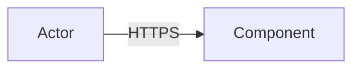

<!-- Use when a system handles sensitive data, spans trust boundaries, is multi-tenant, exposes agent or user input, or enters a regulated or externally reachable environment. -->

# Threat model: <system or change under review>

Scope: <what is in the model, and what is explicitly out of it>
Date: YYYY-MM-DD
Author: <role or name>
Reviewers: <roles who validated it>
Status: Draft | Reviewed | Accepted
Version of system modeled: <commit, release, or deployment id>

## 1. Method

<One paragraph: the method used and why. STRIDE, attack trees, abuse cases, or a hybrid. No taxonomy is complete; the method shapes what gets noticed.>

## 2. Assets

| Asset | Description | Classification | Why it matters | Owner |
|---|---|---|---|---|
| | | Public/Internal/Confidential/Restricted | | |

## 3. Actors

| Actor | Type | Capabilities | Trust level | Notes |
|---|---|---|---|---|
| | Human/Service/Workload/Machine/External | | Trusted/Untrusted/Mixed | |

## 4. Entry points

| Entry point | Protocol | Authentication | Exposure | Data accepted | Rate/abuse controls |
|---|---|---|---|---|---|
| | | | Internet/Internal/VPN/Batch | | |

## 5. Trust boundaries

| Boundary | Between | What crosses it | Controls at the boundary | Failure mode if the boundary fails |
|---|---|---|---|---|
| | | | | |

## 6. Data flows

Describe each flow in prose, then record it. A flow that is not recorded is not modeled.

| Flow ID | From | To | Data | Class | Transport and encryption | Storage touched | Trust boundary crossed |
|---|---|---|---|---|---|---|---|
| F1 | | | | | | | |

Draw the data-flow diagram and keep it consistent with the table.

## 7. Threats

One block per prioritized threat. Use this structure for every entry.

### T-01: <short title>

- Scenario: <attacker or failure, capability, step by step, and the boundary it crosses>
- Affected asset and tenant: <asset from section 2, and blast radius>
- Impact: <concrete outcome, for example unauthorized read of 10,000 records, credential theft, write of a false ledger entry>
- Likelihood basis: <why this rate: capability, exposure, historical incident, published research, or scan result. Mark Assumed if there is no basis>
- Prevention: <the control that blocks it, and the layer that enforces it. Name the mechanism, for example "object-level authorization check inside the owning service, deny by default">
- Detection: <the signal, where it is emitted, and the alert or review that would surface it>
- Response: <containment and recovery steps, with the runbook link>
- Owner: <role accountable>
- Evidence/test: <the test, exercise, or scan that proves the control, and when it last ran>
- Residual risk: <what remains after the controls, accepted by whom>

Repeat the block for each threat. Order blocks by the prioritisation rule below.

## 8. Prioritisation rule

<State the rule before applying it, and apply it consistently.>

- Materiality: a threat is in scope if it can breach an asset in section 2, degrade a critical journey, or produce a reportable event. <Adapt the rule to the organisation, for example "or if it triggers a contractual notification duty">
- Ranking inputs: <impact, likelihood, detectability, blast radius, and how each is scored>
- Tie-break: <what wins when scores are equal, for example "an assumption-driven likelihood ranks below an observed one">
- What is explicitly out of scope and why: <threat class, reason, and who covers it elsewhere>

## 9. Assumptions and accepted risk

| Item | Why accepted | Reviewer | Review date |
|---|---|---|---|
| | | | |

## 10. Review triggers

Revisit this model when any of these changes: <new entry point, new data class, new region, new agent or tool with external input, a dependency or vendor change, a shared responsibility change, an incident involving a modeled threat, a change in the asset list>

## Before you deliver

- Every asset, actor, entry point, and trust boundary in the tables is exercised by at least one threat, and every threat names an asset from section 2.
- No invented numbers. Likelihood and impact carry units or a scale, and a source, or they are marked Assumed with a validation owner.
- Every control names the layer that enforces it. A control that exists only in the threat model is not a control.
- Every threat has an owner and either a test that has run or a named evidence gap.
- Residual risk is stated, not implied, and accepted by a named reviewer.
- Detection, response, and recovery link to a runbook that exists, and restore and rollback are drills with an owner and a date rather than intentions.
- The diagram and the data-flow table agree.
